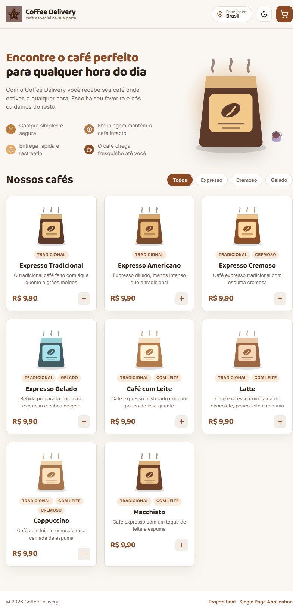
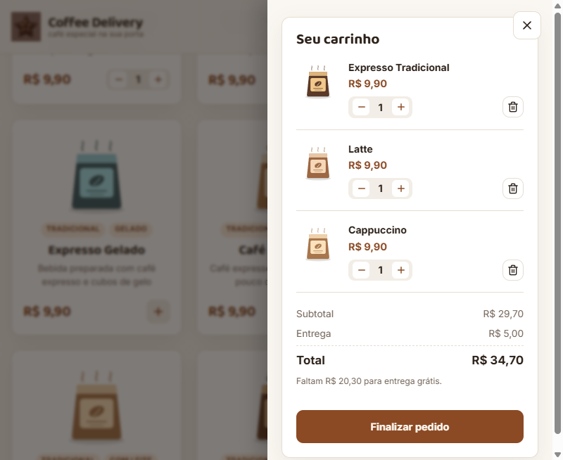
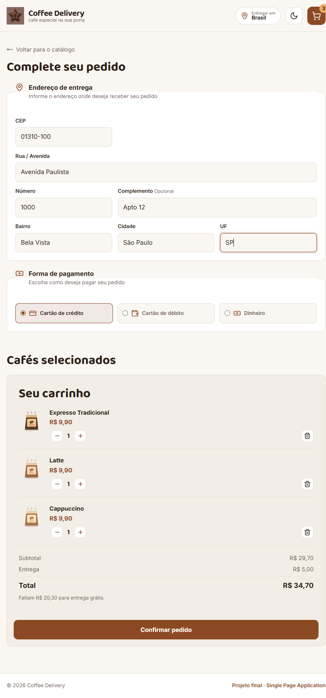
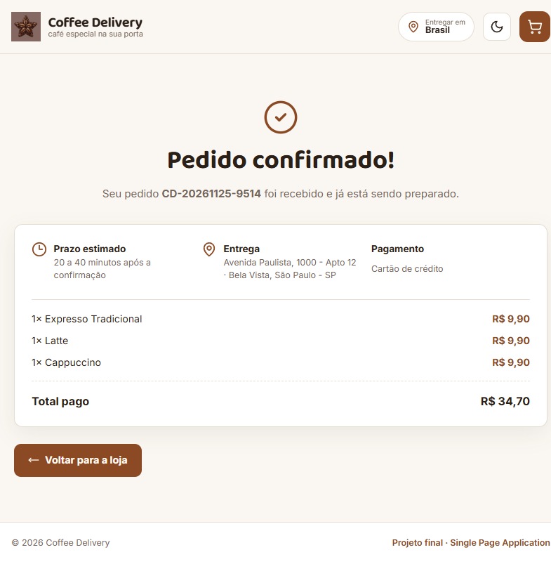
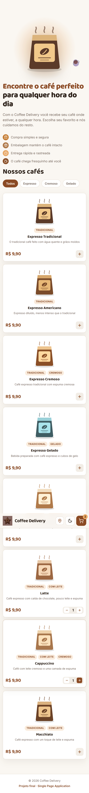
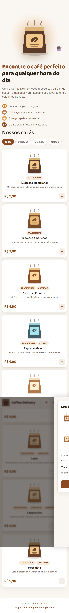
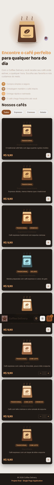

# Coffee Delivery

SPA de e-commerce para uma cafeteria fictícia. O cliente navega pelo catálogo, monta o carrinho, informa endereço e forma de pagamento e recebe uma confirmação com os dados do pedido — tudo no navegador, sem backend.

**Status:** implementado. Verificações automatizadas executadas: `npm run typecheck`, `npm run build`, `npm test` (15 aprovados) e navegação automatizada em navegador para gerar evidências. As 8 capturas já estão em `docs/evidence/`; publicação e conferência humana ainda estão pendentes (ver `TASKS_SPEC.md`).

---

## 📸 Evidências

Capturas já geradas e presentes em `docs/evidence/`. A conferência visual final por uma pessoa ainda está pendente.

| Tela | Prévia | Arquivo |
| --- | --- | --- |
| Catálogo, tema claro |  | `docs/evidence/home-light.png` |
| Carrinho em drawer |  | `docs/evidence/cart-drawer.png` |
| Catálogo, tema escuro |  | `docs/evidence/home-dark.png` |
| Checkout |  | `docs/evidence/checkout.png` |
| Confirmação do pedido |  | `docs/evidence/success.png` |
| Catálogo mobile, tema claro |  | `docs/evidence/mobile-light.png` |
| Carrinho mobile |  | `docs/evidence/mobile-cart.png` |
| Catálogo mobile, tema escuro |  | `docs/evidence/mobile-dark.png` |

As três capturas mobile podem ser regeneradas com `npm run evidence`; veja a seção [Evidências automatizadas](#evidências-automatizadas).

---

## ✨ Funcionalidades

- Catálogo com **8 cafés** e filtros: **Todos, Expresso, Cremoso, Gelado**.
- Cards com ilustração vetorial, tags, descrição, preço e controle de quantidade.
- Carrinho com adicionar, incrementar, decrementar e remover itens; badge no cabeçalho.
- Drawer do carrinho com overlay, botão de fechar e tecla Escape.
- Resumo do carrinho em aside no catálogo (desktop) e no checkout; no checkout o resumo não repete o botão "Finalizar pedido" — a confirmação é feita por "Confirmar pedido".
- Persistência local do carrinho, do tema e do último pedido.
- Tema claro/escuro, com preferência do sistema como fallback.
- Checkout com formulário validado (React Hook Form + Zod): CEP, rua, número, complemento opcional, bairro, cidade, UF e forma de pagamento.
- Página de confirmação com número do pedido, endereço, itens e total.

> **Importante:** o pedido é fictício. Não há cobrança real, gateway de pagamento, API, autenticação, consulta de CEP externa nem rastreamento de entrega. Os textos sobre "entrega rastreada" e "20 a 40 minutos" são informativos e estáticos.

---

## 🛠️ Tecnologias

| Camada | Ferramenta |
| --- | --- |
| Interface | React 18 + TypeScript |
| Build | Vite 5 |
| Rotas | React Router 6 |
| Estado | Context API + useReducer |
| Formulário | React Hook Form + Zod |
| Ícones | lucide-react |
| Estilos | CSS puro com variáveis customizadas |
| Testes | Vitest + Testing Library (jsdom) |
| Evidências | playwright-core (apenas desenvolvimento) |

Versões declaradas em `package.json`. Não há Tailwind, biblioteca de UI ou backend. `playwright-core` não é necessário para build, testes ou execução da aplicação.

---

## 🚀 Como executar

Pré-requisito: Node.js com npm disponível.

```bash
npm install
npm run dev
```

O Vite indica o endereço local (normalmente `http://localhost:5173`).

### Scripts

| Comando | O que faz |
| --- | --- |
| `npm run dev` | Inicia o servidor de desenvolvimento. |
| `npm run build` | Executa `tsc -b` e gera o build em `dist/`. |
| `npm run preview` | Serve localmente o conteúdo de `dist/`. |
| `npm test` | Executa a suíte Vitest uma vez. |
| `npm run test:watch` | Executa Vitest em modo watch. |
| `npm run typecheck` | Verifica os tipos sem emitir arquivos. |
| `npm run evidence` | Gera as 3 capturas mobile em `docs/evidence/`. |

### Evidências automatizadas

`npm run evidence` executa `scripts/capture-evidence.mjs` com `playwright-core` e o Chrome instalado no sistema. O script abre a aplicação em viewport de 390 × 844, adiciona cafés, abre e fecha o carrinho, alterna o tema e salva:

- `docs/evidence/mobile-light.png`
- `docs/evidence/mobile-cart.png`
- `docs/evidence/mobile-dark.png`

Pré-requisitos: `npm run dev` em execução e Chrome disponível. Opcionalmente, defina `BASE_URL` (padrão `http://127.0.0.1:5173`) e `CHROME_PATH`. O script é apenas uma ferramenta de evidências: não participa do build nem dos testes automatizados.

---

## 📁 Estrutura

```text
src/
├── App.tsx                 # providers, BrowserRouter e rotas
├── main.tsx                # ponto de entrada
├── types.ts                # tipos compartilhados
├── data/coffees.ts         # catálogo de 8 cafés e categorias
├── lib/
│   ├── format.ts           # moeda, entrega, CEP e id do pedido
│   └── checkoutSchema.ts   # validação do checkout
├── contexts/
│   ├── CartContext.tsx     # carrinho e totais
│   ├── cartReducer.ts      # transições do carrinho
│   ├── OrderContext.tsx    # último pedido
│   ├── ThemeContext.tsx    # tema claro/escuro
│   └── UiContext.tsx       # abertura do drawer
├── components/             # Header, Layout, Footer, CartPanel, CartDrawer,
│                           # CoffeeCard, CoffeeIllustration, QuantityStepper
├── pages/                  # HomePage, CheckoutPage, SuccessPage
├── styles/global.css       # tokens, componentes e media queries
└── test/                   # setup, renderWithProviders e testes
public/logo.png             # logo criada pelo aluno, usada como favicon e no cabeçalho
scripts/capture-evidence.mjs # capturas mobile (playwright-core)
docs/AI_USAGE.md            # registro de uso de IA
docs/evidence/              # 8 capturas PNG
```

---

## 🧭 Rotas

| Rota | Página | Comportamento |
| --- | --- | --- |
| `/` | `HomePage` | Catálogo com filtros, cards e resumo do carrinho em aside desktop. |
| `/checkout` | `CheckoutPage` | Formulário de endereço, pagamento e resumo; bloqueado se o carrinho estiver vazio. |
| `/sucesso` | `SuccessPage` | Confirmação do último pedido; redireciona para `/` se não houver pedido. |
| `*` | `HomePage` | Qualquer rota desconhecida redireciona para a home. |

---

## 💰 Regras de negócio

| Regra | Valor / comportamento |
| --- | --- |
| Preço de cada café | R$ 9,90 |
| Taxa de entrega | R$ 5,00 se `0 < subtotal < R$ 50,00` |
| Entrega grátis | Subtotal ≥ R$ 50,00 ou carrinho vazio |
| Total | Subtotal + taxa de entrega |
| Pedido vazio | Não pode ser finalizado |
| Pagamento | Obrigatório: crédito, débito ou dinheiro |
| Campos obrigatórios | CEP, rua, número, bairro, cidade e UF |
| Opcional | Complemento (máximo 80 caracteres) |
| CEP | Formato `00000-000`, hífen opcional; máscara aplicada ao digitar |
| UF | Sigla de 2 letras, convertida para maiúsculas |
| Identificador do pedido | `CD-AAAAMMDD-NNNN` (NNNN aleatório) |

Exemplos: 1 café = R$ 14,90 (com entrega); 6 cafés = R$ 59,40 (entrega grátis).

---

## 🧪 Testes

```bash
npm test
```

Suíte atual: **4 arquivos, 15 testes aprovados**.

| Arquivo | Escopo |
| --- | --- |
| `src/contexts/cartReducer.test.ts` | Transições e hidratação do carrinho (5). |
| `src/lib/format.test.ts` | Formatação BRL, taxa de entrega e CEP (3). |
| `src/lib/checkoutSchema.test.ts` | Validação de endereço e pagamento (5). |
| `src/test/cartFlow.test.tsx` | Integração carrinho + persistência e tema (2). |

O ambiente de testes é jsdom. O checklist de verificação manual está em `TECH_SPEC.md`, seção 8.4.

---

## ♿ Acessibilidade e responsividade

- Rótulos acessíveis em ícones e botões, `aria-pressed` nos filtros, `aria-invalid` nos campos e `aria-live` na quantidade.
- Drawer com `role="dialog"`, `aria-modal="true"` e fechamento por Escape.
- Respeito a `prefers-reduced-motion`.
- Breakpoints: **1024 px** (aside oculto e checkout empilhado), **720 px** (hero em coluna, grid 2 colunas, filtros e header compacto), **420 px** (grid e formulário em 1 coluna).

---

## 🚢 Deploy

A aplicação é estática. Em Vercel ou Netlify:

- **Build command:** `npm run build`
- **Output / Publish directory:** `dist`
- **Install command:** `npm install` (padrão)

Alternativa local:

```bash
npm run build
npm run preview
```

Não há variáveis de ambiente obrigatórias. Para que as rotas profundas funcionem após um refresh, o repositório já inclui `vercel.json` (rewrite para `/index.html`) e `public/_redirects` (SPA fallback para Netlify). A rota `*` da aplicação exibe a home para caminhos desconhecidos.

---

## 📌 Status de entrega

| Item | Situação | Link |
| --- | --- | --- |
| Implementação | Concluída | Código em `src/` |
| Verificações automatizadas | Executadas | typecheck, build e 15 testes aprovados |
| Documentação | Concluída | `PRD_SPEC.md`, `TECH_SPEC.md`, `TASKS_SPEC.md`, `AGENTS.md`, `docs/AI_USAGE.md` |
| Evidências visuais | Geradas | 8 PNGs em `docs/evidence/` |
| Conferência humana | Pendente | Regras monetárias, textos, acessibilidade, imagens e registro de IA |
| Repositório GitHub | Pendente | `URL_DO_REPOSITORIO` |
| Deploy | Pendente | `URL_DO_DEPLOY` |

Substitua os marcadores acima pelos links reais quando a publicação for concluída.

---

## 🤖 Uso de IA

O assistente OpenCode (modelo Big Pickle) apoiou planejamento, arquitetura, código, revisão de tipos, testes e documentação. Uma tentativa de gerar a logo com ferramenta de imagem falhou por credencial inválida; a logo final foi criada pelo autor do projeto (`public/logo.png`) e integrada pelo assistente. Detalhes, prompts representativos e a distinção entre verificações automatizadas e itens pendentes de confirmação humana estão em `docs/AI_USAGE.md`.
